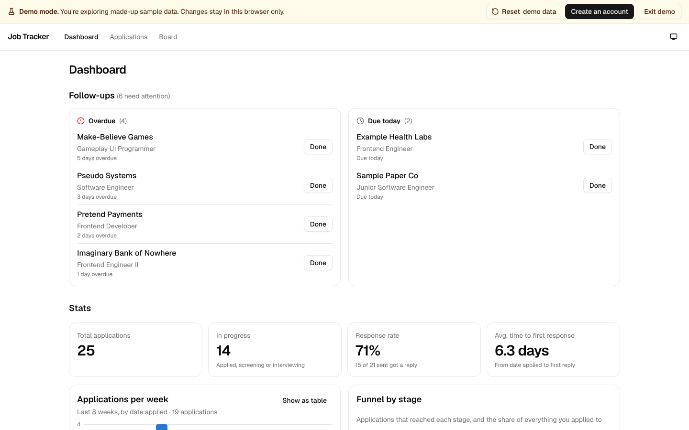
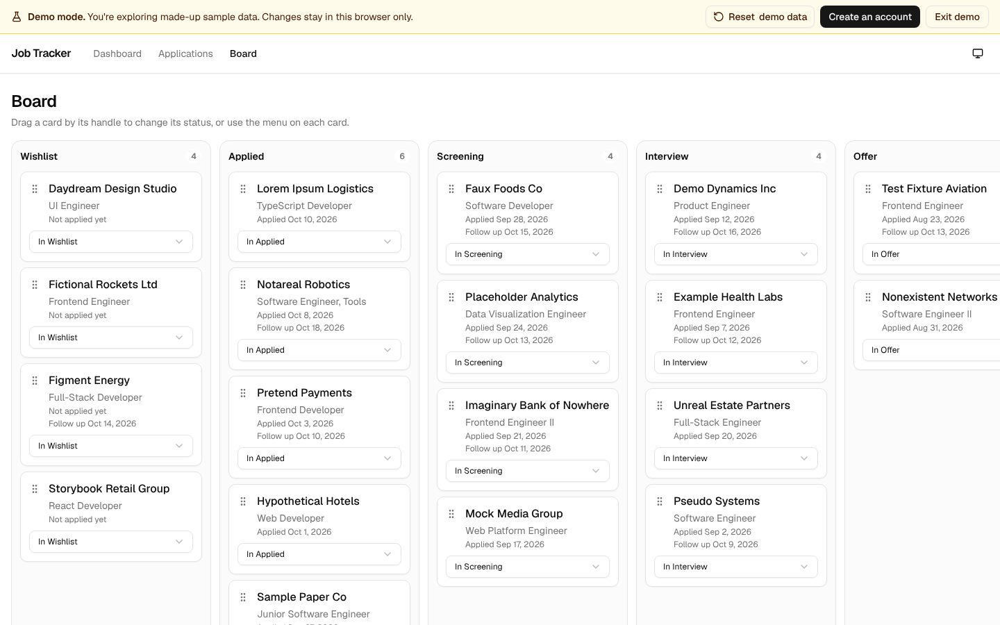
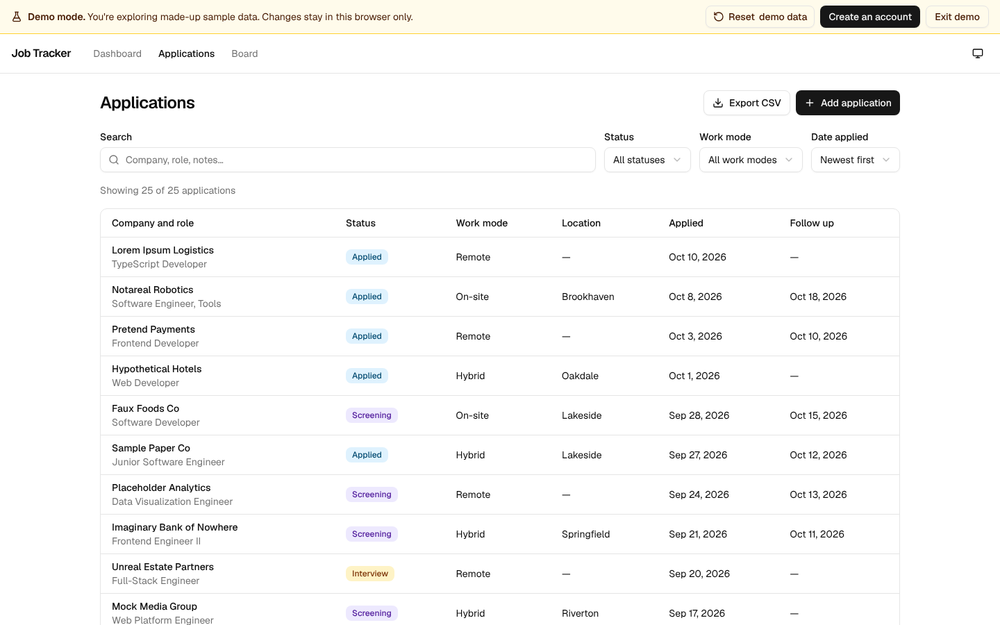
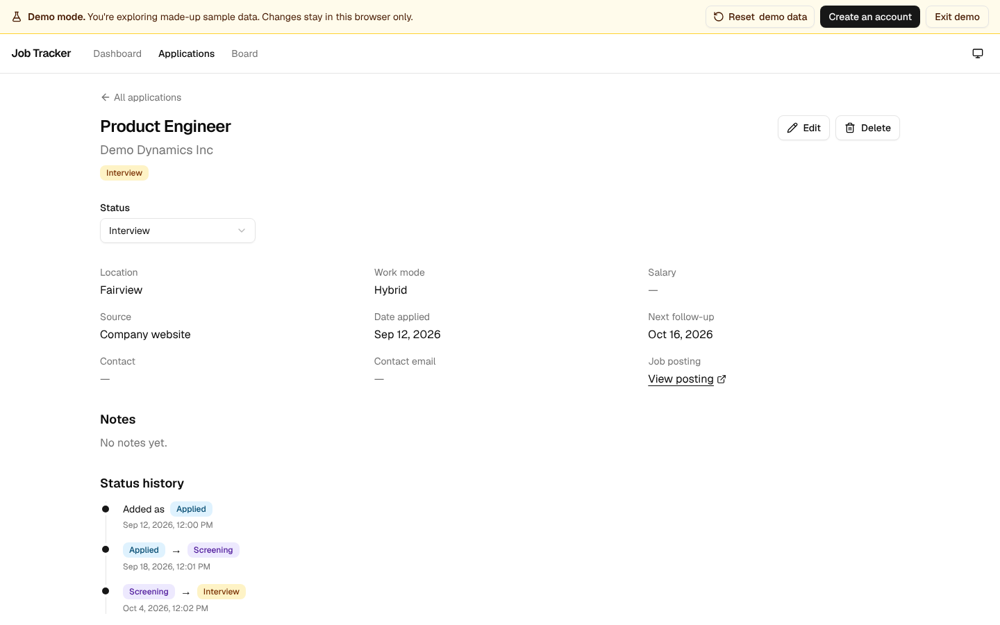
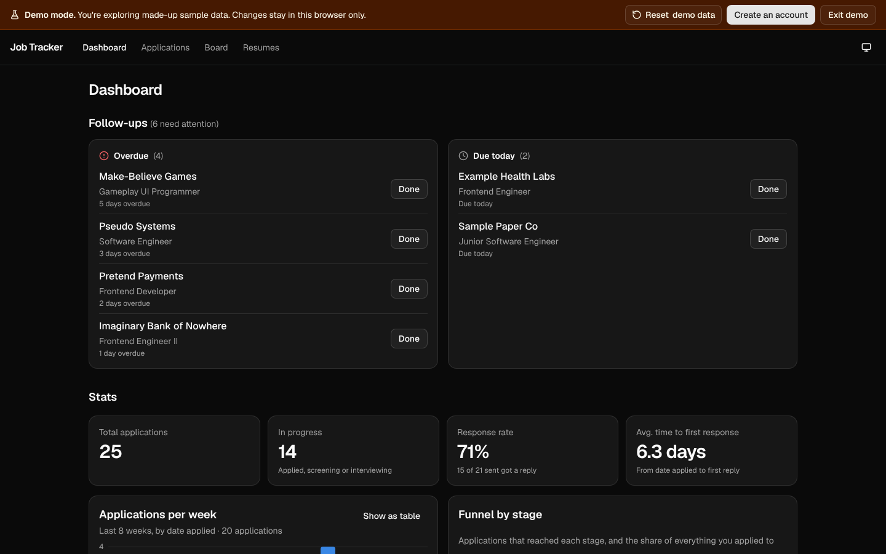
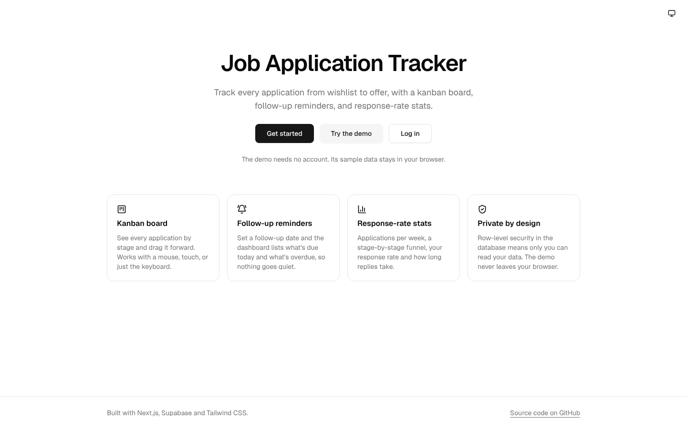
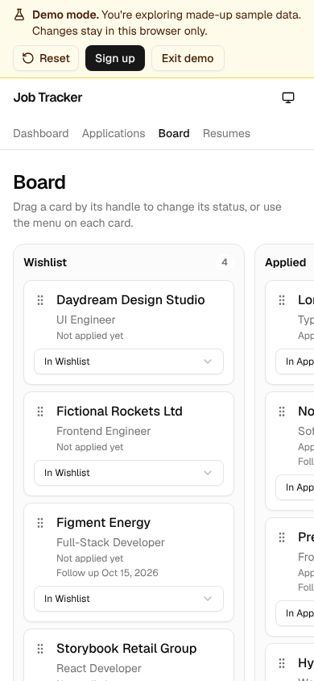
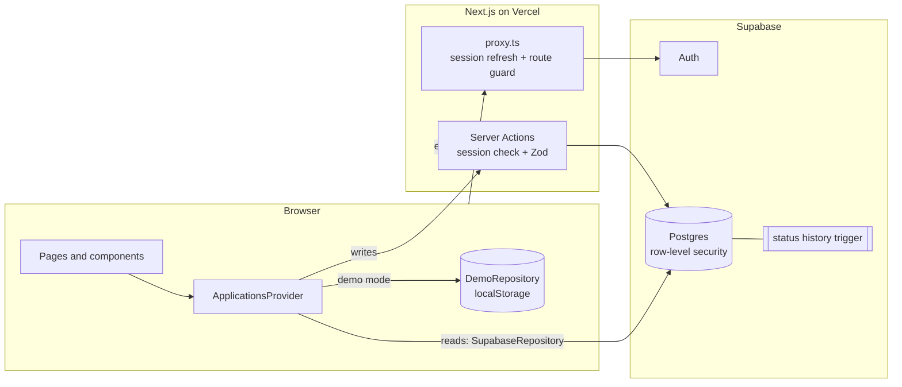

# Job Application Tracker

[](https://github.com/proyneon-hub/Job-Application-Tracker/actions/workflows/ci.yml)
[](LICENSE)

Track every job application from wishlist to offer: a kanban board, follow-up reminders, and response-rate stats, with each user's data kept private by row-level security in the database.

**Live demo:** _coming soon_ · Click **Try the demo** on the landing page to explore with made-up sample data. No account needed.

## What it does and why

Job hunting means dozens of applications at different stages, recruiters to chase, and little sense of what's working. Spreadsheets get messy fast. This app keeps it all in one place:

- **Applications:** company, role, posting link, location, work mode, salary range, source, status, dates, contact and notes. Create, edit and delete.
- **Kanban board:** one column per status. Drag cards with a mouse, touch, or **just the keyboard**; every card also has a "Move to…" menu.
- **Status history:** every status change is recorded automatically and shown as a timeline.
- **Table view:** search, filter by status and work mode, and sort by date applied.
- **Follow-ups:** the dashboard lists what's due today and what's overdue.
- **Stats:** total applications, response rate, average days to first response, applications per week, and a stage-by-stage funnel.
- **CSV export**, **dark mode**, and a **demo mode** that runs entirely in your browser.

## Screenshots

All screenshots use the fictional demo data. Regenerate them with `npm run screenshots`.

| Dashboard                                                                           | Board                                                                                      |
| ----------------------------------------------------------------------------------- | ------------------------------------------------------------------------------------------ |
|  |                        |
| **Applications table**                                                              | **Application detail with status history**                                                 |
|     |  |
| **Dark mode**                                                                       | **Landing page**                                                                           |
|                       |                         |

<p align="center"></p>

## Tech stack

| Tool                                       | Why                                                                                                               |
| ------------------------------------------ | ----------------------------------------------------------------------------------------------------------------- |
| **Next.js 16** (App Router), **React 19**  | Server Components, Server Actions and route protection in one framework; Cache Components for fast static shells. |
| **TypeScript** (strict)                    | Catches mistakes at compile time; database types are generated from the schema.                                   |
| **Tailwind CSS 4** + **shadcn/ui** (Radix) | Accessible components I own as source files, styled with design tokens for light and dark mode.                   |
| **Supabase** (Postgres + Auth)             | Email/password auth, and Postgres row-level security to enforce privacy in the database itself.                   |
| **Zod**                                    | One set of validation rules shared by the forms (instant feedback) and the server (the real check).               |
| **dnd-kit**                                | Drag and drop with first-class keyboard and screen-reader support.                                                |
| **Vitest** + Testing Library               | Fast unit and component tests.                                                                                    |
| **Playwright** + **axe-core**              | End-to-end tests in a real browser, including automated WCAG 2.2 AA checks in both themes.                        |
| **pgTAP**                                  | Database tests that prove one user can't read or change another user's data.                                      |
| **GitHub Actions**, **Vercel**             | CI on every pull request, and hosting.                                                                            |

## Architecture overview



- **One data interface, two implementations.** The UI only talks to `ApplicationsRepository` (`src/lib/repository/types.ts`).
  - `SupabaseRepository` reads straight from Supabase in the browser; row-level security returns only the user's own rows. Writes go through Server Actions that check the session and validate with Zod.
  - `DemoRepository` keeps everything in `localStorage`, validates with the **same** Zod schema, and records history the same way the database does. Demo data never touches the server.
- **Status history is a database trigger** (`supabase/migrations/…_create_triggers.sql`). It can't be skipped or faked by app code and is written in the same transaction as the change.
- **Pages are private by default.** `src/proxy.ts` (Next 16's renamed middleware) redirects logged-out visitors to log in unless a path is explicitly public. The rules are a pure, unit-tested function in `src/lib/auth/routes.ts`.
- **Stats are pure functions** in `src/lib/stats/`, with unit tests and the definitions written down:
  - **Sent:** has a date applied, or reached Applied or later.
  - **Response:** the first move to Screening, Interview, Offer or Rejected.
  - **Funnel:** counts the furthest stage each application reached.

```
src/
  app/            routes: (auth) pages, (app) logged-in pages, auth/confirm, demo routes
  components/     ui/ (shadcn), applications/, board/, dashboard/, layout/, forms/
  lib/            repository/, actions/, validation/, stats/, board/, demo/, supabase/, auth/, theme/
  proxy.ts        session refresh + route guard
supabase/         migrations/, tests/ (pgTAP), config.toml, email templates
e2e/              Playwright tests (board, dashboard, demo, a11y, responsive, polish)
```

## Privacy and security

**Row-level security (RLS) does the enforcing.** The browser talks to Supabase with a public "publishable" key, so the database itself has to decide who can see what. Every table has RLS enabled, with policies like:

```sql
create policy "Users can read their own applications"
  on public.applications for select
  to authenticated
  using ((select auth.uid()) = user_id);
```

There are matching policies for insert, update and delete. `status_events` is **read-only** for users: only the trigger can write it, so history can't be forged. Logged-out visitors (the `anon` role) have no table access at all.

**How it's proven.** `supabase/tests/rls.test.sql` is a pgTAP test that runs in CI against a real Supabase stack. It creates two users and checks 17 things, including that user B:

- can't read, update or delete user A's applications or history;
- can't create rows owned by A;
- can't write history directly;

and that anonymous visitors can't read anything. With RLS turned off, 8 of those checks fail, so the test really guards it.

**Manual check** (on your own Supabase project):

1. Sign up as two users in two browsers (or one normal and one private window) and add an application as each.
2. Each user's table shows only their own application.
3. In the Supabase SQL editor, pretend to be user B and try to read A's data. This returns 0 rows (find the ids under **Authentication → Users**):
   ```sql
   begin;
   set local role authenticated;
   select set_config('request.jwt.claims', '{"sub":"<user B id>","role":"authenticated"}', true);
   select * from public.applications where user_id = '<user A id>';
   rollback;
   ```

**Also:**

- **No service-role key** anywhere. Every query runs as the logged-in user. `.env.example` holds only the URL and publishable key.
- **Server-side validation:** every Server Action checks the session and validates all input with Zod; arguments are typed `unknown` until parsed.
- **Auth hygiene:** redirects after login only go to same-site paths (no open redirects), and sign-up and password-reset messages never reveal whether an email has an account.
- **Safe output:** links must be `http(s)` (no `javascript:` URLs), and CSV export guards against formula injection.
- **Security headers:** no framing, `nosniff`, strict referrer policy, and no camera, microphone or geolocation access.
- **Demo isolation:** demo data stays in the visitor's browser, and the demo cookie grants no database access.
- **Fictional data only:** the seed data, tests and screenshots use invented companies and reserved `.test` email domains.

## Local setup

**You need:** Node.js 22 (see `.nvmrc`) and a Supabase database, either option A or B below.

```bash
git clone https://github.com/proyneon-hub/Job-Application-Tracker.git
cd Job-Application-Tracker
npm install
cp .env.example .env.local   # then fill in the two values
```

**Option A: a hosted Supabase project (free tier)**

1. Create a project at supabase.com.
2. Open **SQL Editor**, then run each file in `supabase/migrations/` in order. Or link the project with the CLI and push the migrations:
   ```bash
   npx supabase login
   npx supabase link --project-ref <ref>
   npx supabase db push
   ```
3. Under **Authentication → Sign In / Providers → Email**, keep "Confirm email" on and set the minimum password length to 8.
4. Under **Authentication → URL Configuration**, set the Site URL to `http://localhost:3000` and add `http://localhost:3000/**` to the Redirect URLs.
5. Under **Authentication → Emails**, paste in the templates from `supabase/templates/`.
6. Copy the **Project URL** and **Publishable key** into `.env.local`.

**Option B: local Supabase in Docker.** This needs Docker Desktop. `npm run db:start` starts Postgres, Auth and a fake inbox at http://127.0.0.1:54324, all built from this repo's migrations. Put the URL and publishable key it prints into `.env.local`.

Then run `npm run dev` and open http://localhost:3000. You can also click **Try the demo**, which needs no database.

| Script                                  | What it does                                              |
| --------------------------------------- | --------------------------------------------------------- |
| `npm run dev` / `build` / `start`       | Develop, build, or serve the production build             |
| `npm run lint` / `typecheck` / `format` | ESLint (zero warnings), TypeScript, Prettier              |
| `npm test`                              | Unit and component tests (Vitest)                         |
| `npm run test:e2e`                      | Playwright tests against a production build, in demo mode |
| `npm run db:start` / `db:reset`         | Start or rebuild the local Supabase stack (Docker)        |
| `npm run db:test`                       | Row-level security tests (pgTAP)                          |
| `npm run db:types`                      | Regenerate database types from the local schema           |
| `npm run screenshots`                   | Regenerate the README screenshots                         |

## Testing strategy

- **Unit tests (Vitest)** cover the logic that's easy to get subtly wrong:
  - validation rules, stats definitions, filtering and sorting;
  - date maths without timezone shifts, CSV escaping;
  - the route rules, the demo repository, the keyboard drag helper, and the theme script.
- **Component tests** check forms show errors on the right fields and that the board's "Move to" menu works without dragging.
- **End-to-end tests (Playwright)** run in demo mode, so CI needs no secrets:
  - drag and drop by keyboard and by mouse, follow-ups, reset and exit demo, CSV download and dark mode;
  - no sideways scrolling on 360px phones, and axe-core WCAG 2.2 AA scans in light and dark.
- **Database tests (pgTAP)** prove row-level security on a real Supabase stack in CI.
- **Tests of the tests.** Before trusting a test, I broke the code it protects and checked that it failed:
  - with RLS disabled, the database test fails;
  - with the keyboard drag helper broken, the board test fails;
  - injecting low-contrast text and an image without alt text makes the axe scan fail.

  One of these checks found a real gap: at laptop width the browser's own scroll-snap moved the board for the keyboard test, so it passed even with the helper broken. The keyboard test now also runs on a screen wide enough that the board can't scroll.

## Decisions and trade-offs

- **App data loads in the browser** through the repository instead of in Server Components. That gives one code path for real and demo data. The cost is a brief loading skeleton.
- **Demo mode lives in the browser** rather than using Supabase anonymous sign-in. That means no junk accounts in the database, no cleanup jobs, and no abuse surface.
- **No chart or theme library.** Two simple charts are plain HTML/CSS with a colour checked for colour-blind readability, and dark mode is a tiny inline script that runs before first paint, so there's no flash.
- **The demo banner streams in.** It reads a cookie, so it renders behind `<Suspense>`, and React 19 waits about 300ms before revealing streamed content. On a full page load it appears a moment late and nudges the page down about 49px, well within "good" layout-shift scores.
- **Native `<select>` elements** for filters and status menus: accessible by default, with the phone's own picker on mobile.

## Future ideas

- **Email reminders** for follow-ups, which needs custom SMTP and a scheduled job.
- **File uploads** to keep CV and cover-letter versions with each application.
- **AI features:** summarise a job posting, or draft follow-up emails.
- **Browser extension** to save a job straight from a job board.
- **Team or coach accounts** for sharing progress with a mentor.
- **Account management:** delete my account and data, and export everything as JSON.
- **Offline support / PWA.**
- **Content-Security-Policy** with a nonce for the inline theme script.

## License

[MIT](LICENSE)
